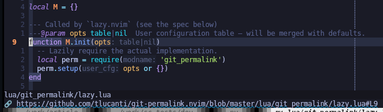

# git-permalink.nvim

Create a **permalink** for the **current line in file** on GitHub, GitLab or Bitbucket and copy it to the system clipboard.



Get a link at the bottom status bar in one click

## Features

* Works with public and self‑hosted GitHub/GitLab/Bitbucket instances.
* Handles private repositories, custom hostnames and SSH URLs.
* Supports both branch names and detached‑HEAD SHA.
* Zero‑dependency – pure Lua, works with any Neovim ≥ 0.9
* Full lazy.nvim integration (key‑mapping, command, options).

## Installation

default configuration:

```lua
-- lazy.nvim
require("lazy").setup({
  {
    "tlucanti/git-permalink.nvim",
    opts = {
      remote_name = "origin",
      lhs = "<C-l>",
      mode = "n",
    }
    cmd = "GitPermalink",
  },
})
